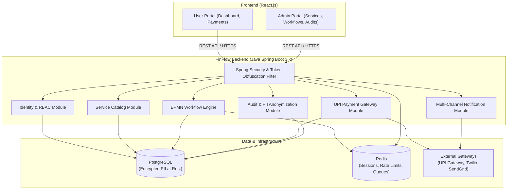
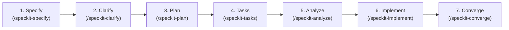

# FinFlow — Personal Finance & Service Manager

[](#system-architecture)
[](backend/README.md)
[-61DAFB.svg)](frontend/README.md)
[-green.svg)](backend/README.md#contract-first-api-development-openapi)
[](#technology-stack)
[](#working-with-speckit)

FinFlow is a secure, enterprise-grade personal finance application designed to grant users complete visibility and control over their recurring financial services, bill payments, and subscriptions, while providing administrators with a powerful, dynamic workflow management engine.

---

## Table of Contents

- [Application Overview](#application-overview)
- [Key Features](#key-features)
- [System Architecture](#system-architecture)
- [Technology Stack](#technology-stack)
- [Repository Structure & Sub-Readmes](#repository-structure--sub-readmes)
- [Working with Speckit (Spec-Driven Development)](#working-with-speckit)
- [Quickstart Guide](#quickstart-guide)
- [Security & Compliance Highlights](#security--compliance-highlights)
- [Source Specifications](#source-specifications)

---

## Application Overview

FinFlow bridges personal financial management with configurable service administration. Users can request access to services, track payment obligations, pay seamlessly through an integrated UPI payment gateway, and receive timely multi-channel notifications. Administrators can dynamically onboard services and configure BPMN-based lifecycle workflows (e.g., payment reminders, due-expiry alerts, reschedule policies) without altering codebase logic.

### Core Value Proposition

- **User Empowerment**: Centralized hub to manage bill payments, dynamic subscriptions, and track privilege requests.
- **Operational Agility**: Dynamic administrative service catalog and visual workflow design.
- **Enterprise Security**: Field-level encryption for sensitive user data (PII), session-bound obfuscated database IDs, and OAuth2 + TOTP two-factor authentication.
- **Auditability**: Complete user activity tracking with privacy masking and tokenized logs.

---

## Key Features

| Domain | Features |
| :--- | :--- |
| **API Contracts** | Strict Contract-First development via OpenAPI 3.0/3.1; single source of truth generating Spring Boot controllers and typed React client SDKs. |
| **Identity & Access (RBAC)** | Role-based access control (Admin, User), dynamic user privilege request & admin approval workflows, OAuth2 (Google) + 2FA (TOTP). |
| **Service Catalog** | Pre-configured services (e.g., Bill Payment, Subscription Manager) and dynamic administrative service creation. |
| **Workflow Engine** | Configurable BPMN lifecycle steps: pre-payment notices, post-payment confirmations, due-expiry alerts, rescheduling, and payment screenshot verification. |
| **Payments (UPI)** | Native UPI gateway integration (e.g., Razorpay / Cashfree), webhook verification with idempotency protection. |
| **Notifications** | Multi-channel messaging via Email, SMS, WhatsApp, and in-app alerts. |
| **Security & Privacy** | AES-256-GCM encryption at rest for PII, per-session ID token obfuscation (anti-scraping/tampering), immutable audit logs. |
| **Database Migrations** | Liquibase schema evolution with master changelogs, semantic versioning, and mandatory rollback plans for every changeset. |
| **Audit & State Tracking** | Dedicated shadow audit tables (`*_aud`) for every domain entity, capturing point-in-time state changes and diffs. |

---

## System Architecture

FinFlow is structured as a **modular monolith**, packaging business capabilities into cohesive backend domain modules with a high-performance React frontend and unified deployment orchestration.



---

## Technology Stack

The application stack centers on **Java Spring Boot** and **React.js**:

| Tier | Technology | Description / Justification |
| :--- | :--- | :--- |
| **Backend** | **Java 17/21 + Spring Boot 3.x** | Enterprise-grade, type-safe backend providing robust transaction management, Spring Security, Spring Data JPA, and high-throughput execution. |
| **Frontend** | **React.js (Vite)** | Modern, responsive SPA with fast rendering, modular components, and client-side routing for user and admin portals. |
| **API Contracts** | **OpenAPI 3.0 / 3.1** | Canonical Contract-First specifications (`api/openapi/`); drives BE controller stubs and FE typed client generation. |
| **Primary Database & Migrations** | **PostgreSQL 15+ + Liquibase** | Relational ACID storage, versioned changesets, master changelogs, and mandatory automated rollback plans. |
| **Audit Architecture** | **Per-Table Shadow Tables (`*_aud`)** | Captures all domain entity state mutations and diffs for point-in-time audit querying and compliance. |
| **Cache & Queue** | **Redis** | High-performance in-memory store for distributed session states, rate limiting, and workflow event queues. |
| **Security & Crypto** | **Spring Security + BouncyCastle / JCE** | OAuth2 (Google), TOTP (Time-based One-Time Password), AES-256-GCM field encryption, and ephemeral ID token hashing. |
| **Workflow Engine** | **Camunda / Flowable / Spring StateMachine** | BPMN-compliant workflow execution for customizable service lifecycles. |
| **Payments** | **UPI Gateway SDK (Razorpay / Cashfree)** | Payment initiation, QR/UPI intent, and idempotent webhook processing. |
| **Deployment** | **Docker & Docker Compose** | Unified containerization for local development and cloud production deployment. |

---

## Repository Structure & Sub-Readmes

FinFlow maintains dedicated documentation for each module within the monolith:

```text
finflow/
├── README.md               # Main project overview and Speckit guide (this file)
├── backend/                # Java Spring Boot backend application
│   └── README.md           # Backend setup, architecture, and API guide -> [backend/README.md](backend/README.md)
├── be                      # Symlink alias to backend/
├── frontend/               # React.js frontend application
│   └── README.md           # Frontend setup, state management, and UI guide -> [frontend/README.md](frontend/README.md)
├── fe                      # Symlink alias to frontend/
├── deploy/                 # Docker Compose, environment configurations & CI/CD
│   └── README.md           # Container orchestration & deployment guide -> [deploy/README.md](deploy/README.md)
├── sources/                # Upstream specifications (BRD, SRS, Technical Overview)
│   ├── finflow-brd.md
│   ├── finflow-srs.md
│   └── finflow-technical-overview.md
├── .specify/               # Speckit workflows, templates, and configuration
└── .agents/                # AI Agent skill definitions
```

### Module Documentation Links

1. ☕ **Backend Documentation**: [`backend/README.md`](backend/README.md) (or [`be/README.md`](be/README.md))  
   *Architecture, domain packaging, Spring Security configuration, AES-256-GCM encryption, database migrations, and testing.*
2. ⚛️ **Frontend Documentation**: [`frontend/README.md`](frontend/README.md) (or [`fe/README.md`](fe/README.md))  
   *React application structure, authentication flows, ID token handling & retry mechanisms, UI component library, and Vite setup.*
3. 🚀 **Deployment Documentation**: [`deploy/README.md`](deploy/README.md)  
   *Docker Compose monolith orchestration, environment profiles, database initialization, Redis setup, and Kubernetes readiness.*

---

## Working with Speckit

FinFlow is built using **Speckit (Spec-Driven Development / SDD)**. Under SDD, software specifications serve as the single source of truth, guiding planning, task generation, and automated or semi-automated implementation.



### Speckit Development Workflow

Every new feature or capability in FinFlow follows this lifecycle:

#### 1. Define Specifications (`/speckit-specify`)
Create a structured specification from a natural language requirement:
```bash
# Example invocation with AI assistant
/speckit-specify "Implement user privilege request approval workflow for admins"
```
- Output: Creates a spec in `specs/<feature-number>-<feature-name>/spec.md` using `.specify/templates/spec-template.md`.
- Generates a quality validation checklist in `specs/<feature>/checklists/requirements.md`.

#### 2. Clarify Requirements (`/speckit-clarify`)
Resolve any ambiguous requirements or `[NEEDS CLARIFICATION]` tags before writing code:
```bash
/speckit-clarify
```
- Asks targeted, high-impact questions and updates the specification with ratified choices.

#### 3. Technical Architecture & Planning (`/speckit-plan`)
Formulate the architectural design adhering to FinFlow's Java Spring Boot and React stack:
```bash
/speckit-plan
```
- Output: Creates `specs/<feature>/plan.md` defining data contracts, entities, security flows, and endpoints.

#### 4. Task Breakdown (`/speckit-tasks`)
Deconstruct the plan into dependency-ordered, actionable tasks:
```bash
/speckit-tasks
```
- Output: Creates `specs/<feature>/tasks.md` categorized into Setup, Foundational, Core Implementation, and Polish phases.

#### 5. Artifact Consistency Check (`/speckit-analyze`)
Run non-destructive cross-validation across `spec.md`, `plan.md`, and `tasks.md`:
```bash
/speckit-analyze
```

#### 6. Task Implementation (`/speckit-implement`)
Execute the implementation tasks systematically against the codebase:
```bash
/speckit-implement
```

#### 7. Verify & Converge (`/speckit-converge`)
Assess the built code against the original specification and identify any remaining gaps:
```bash
/speckit-converge
```

### Speckit Governance & Principles
Project engineering standards are defined in [`.specify/memory/constitution.md`](.specify/memory/constitution.md). All AI agents and developers must respect non-negotiables such as Test-Driven Development (TDD), zero PII in raw logs, and mandatory encryption.

---

## Quickstart Guide

### Prerequisites
- **JDK 17 or 21**
- **Node.js 18+ & npm**
- **Docker & Docker Compose** (for PostgreSQL and Redis)
- **Maven 3.8+** (or included `./mvnw`)

### 1. Start Infrastructure Services
Use Docker Compose to launch PostgreSQL and Redis:
```bash
docker compose -f deploy/docker-compose.yml up -d postgres redis
```

### 2. Run Backend (Java Spring Boot)
```bash
cd backend
# or cd be
./mvnw clean spring-boot:run
```
*The backend API will be available at: `http://localhost:8080`*

### 3. Run Frontend (React.js)
```bash
cd frontend
# or cd fe
npm install
npm run dev
```
*The frontend application will be available at: `http://localhost:5173`*

---

## Security & Compliance Highlights

- **Field-Level Encryption**: All Personally Identifiable Information (PII) including email, phone numbers, and names are encrypted at rest using AES-256-GCM.
- **Per-Session ID Obfuscation**: Internal database primary keys (UUIDs/IDs) are never returned in plain text to the browser. Endpoints issue and accept encrypted tokens scoped to the active session.
  - *Retry & Lockout*: If token decryption fails, the client triggers a token refresh. After three consecutive decryption failures within a session, the system invalidates the session and requires a fresh login.
- **Sanitized Audit Trails**: Audit records log user actions, IP addresses, and timestamps with tokenized identifiers, ensuring zero plain-text PII is persisted in logs.
- **OWASP Compliance**: Designed to strictly mitigate the OWASP Top 10 vulnerabilities (Injection, Broken Authentication, Sensitive Data Exposure, etc.).

---

## Source Specifications

The core business and system requirements are located in [`sources/`](sources/):
- 📄 [Business Requirements Document (BRD)](sources/finflow-brd.md)
- 📄 [Software Requirements Specification (SRS)](sources/finflow-srs.md)
- 📄 [Technical Overview Document](sources/finflow-technical-overview.md)
