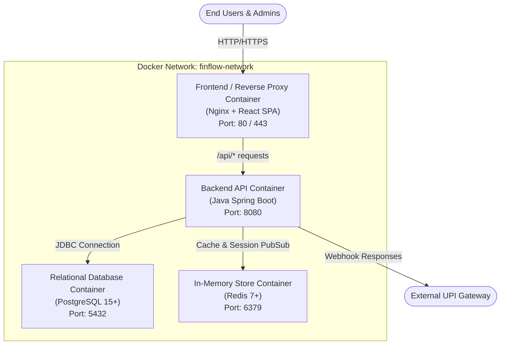
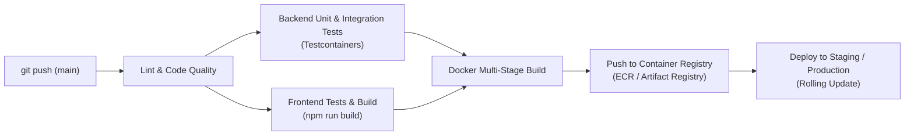

# FinFlow Deployment & Infrastructure Guide

[](https://www.docker.com/)
[](https://docs.docker.com/compose/)
[](https://www.postgresql.org/)
[](https://redis.io/)
[](#cloud--kubernetes-production-architecture)

This directory contains deployment orchestration, container configuration, environment templates, and infrastructure recipes for the **FinFlow** modular monolith application.

---

## Table of Contents

- [Deployment Architecture](#deployment-architecture)
- [Directory Layout](#directory-layout)
- [Local Development Orchestration (Docker Compose)](#local-development-orchestration-docker-compose)
  - [1. Running Infrastructure Only](#1-running-infrastructure-only)
  - [2. Running the Full Stack Monolith](#2-running-the-full-stack-monolith)
- [Environment Configuration & Secrets](#environment-configuration--secrets)
- [Cloud & Kubernetes Production Architecture](#cloud--kubernetes-production-architecture)
- [Observability, Metrics & Health Checks](#observability-metrics--health-checks)
- [CI/CD Pipeline Overview](#cicd-pipeline-overview)
- [Backup & Disaster Recovery](#backup--disaster-recovery)

---

## Deployment Architecture

FinFlow is containerized and managed as a unified modular system consisting of four primary services:



---

## Directory Layout

```text
deploy/
├── README.md                    # Deployment and operations documentation (this file)
├── docker-compose.yml           # Unified multi-container configuration for local stack
├── docker-compose.infra.yml     # Lightweight compose file for databases only (Postgres + Redis)
├── docker/
│   ├── backend.Dockerfile       # Multi-stage JDK 17/21 Dockerfile for Spring Boot
│   ├── frontend.Dockerfile      # Multi-stage Node.js build + Nginx runtime Dockerfile
│   └── nginx.conf               # Nginx reverse proxy configuration
├── env/
│   ├── .env.example             # Base environment variable template
│   ├── .env.development         # Local development overrides
│   └── .env.production          # Production environment sample
└── k8s/                         # Kubernetes deployment manifests
    ├── backend-deployment.yaml
    ├── frontend-deployment.yaml
    ├── postgres-statefulset.yaml
    ├── redis-deployment.yaml
    └── ingress.yaml
```

---

## Local Development Orchestration (Docker Compose)

### 1. Running Infrastructure Only
If developing backend or frontend locally on your host machine, spin up just PostgreSQL and Redis:

```bash
# From repository root
docker compose -f deploy/docker-compose.infra.yml up -d
```

To stop:
```bash
docker compose -f deploy/docker-compose.infra.yml down
```

### 2. Running the Full Stack Monolith
To launch the complete application stack (Backend, Frontend, PostgreSQL, and Redis) inside containers:

```bash
# 1. Copy sample environment file
cp deploy/env/.env.example deploy/env/.env

# 2. Build and run all services
docker compose -f deploy/docker-compose.yml up --build -d
```

### Verification
- **Frontend Web UI**: `http://localhost:80` (or `http://localhost:5173` for Vite dev server)
- **Backend Health Check**: `http://localhost:8080/actuator/health`
- **PostgreSQL**: `localhost:5432` (`finflow_db`)
- **Redis**: `localhost:6379`

---

## Environment Configuration & Secrets

> [!IMPORTANT]
> Never commit active credentials, private encryption keys, or OAuth secrets to version control.

### Critical Environment Variables

| Variable | Description | Recommended Source (Prod) |
| :--- | :--- | :--- |
| `SPRING_PROFILES_ACTIVE` | Active profile (`dev`, `prod`) | Container Environment |
| `DATABASE_URL` | PostgreSQL JDBC connection URL | AWS RDS / Cloud SQL endpoint |
| `DATABASE_USERNAME` | DB username | AWS Secrets Manager / Vault |
| `DATABASE_PASSWORD` | DB password | AWS Secrets Manager / Vault |
| `REDIS_HOST` | Redis hostname | AWS ElastiCache / Managed Redis |
| `REDIS_PASSWORD` | Redis auth secret | AWS Secrets Manager / Vault |
| `PII_ENCRYPTION_KEY` | 256-bit Base64 AES key for PII | AWS KMS / Secret Manager |
| `JWT_SECRET` | Secret key for signing session JWTs | AWS Secrets Manager / Vault |
| `RAZORPAY_KEY_ID` | UPI Payment Gateway client ID | Environment Secret |
| `RAZORPAY_KEY_SECRET` | UPI Payment Gateway webhook secret | Environment Secret |

---

## Cloud & Kubernetes Production Architecture

For production environments on **AWS (EKS)** or **GCP (GKE)**:

1. **Database & Persistence**:
   - Use managed PostgreSQL (e.g. AWS RDS Multi-AZ) for automatic failover and automated daily snapshots.
   - Use managed Redis (e.g. AWS ElastiCache) with replication.
2. **Container Orchestration**:
   - Deploy backend pods using the Spring Boot image with horizontal pod autoscaling (HPA) targeting CPU > 70%.
   - Ingress controller (Nginx Ingress / AWS ALB) terminating TLS 1.3.
3. **Secret Management**:
   - Integrate with AWS Secrets Manager via External Secrets Operator (ESO) to inject secrets directly into Kubernetes Secret resources.

---

## Observability, Metrics & Health Checks

- **Spring Boot Actuator**:
  - `/actuator/health`: Liveness and readiness probes for Kubernetes.
  - `/actuator/metrics`: JVM, connection pool, and HTTP request metrics.
  - `/actuator/prometheus`: Prometheus-compatible metrics endpoint.
- **Metrics Collection**: Scraped by Prometheus and visualized using curated Grafana dashboards.
- **Log Aggregation**:
  - Structured JSON logs emitted to stdout/stderr.
  - Collected via Fluentd / Promtail and shipped to Grafana Loki or Elasticsearch.
  - All logs scrubbed of PII per SRS FR-AUD-03 requirements.

---

## CI/CD Pipeline Overview

Automated with GitHub Actions or GitLab CI:



---

## Backup & Disaster Recovery

1. **Database Snapshots**: Automated continuous WAL archiving with point-in-time recovery (PITR) up to 35 days.
2. **Disaster Recovery (DR) Plan**: Target Recovery Point Objective (RPO) < 5 minutes, Recovery Time Objective (RTO) < 30 minutes in a secondary cloud availability zone.
