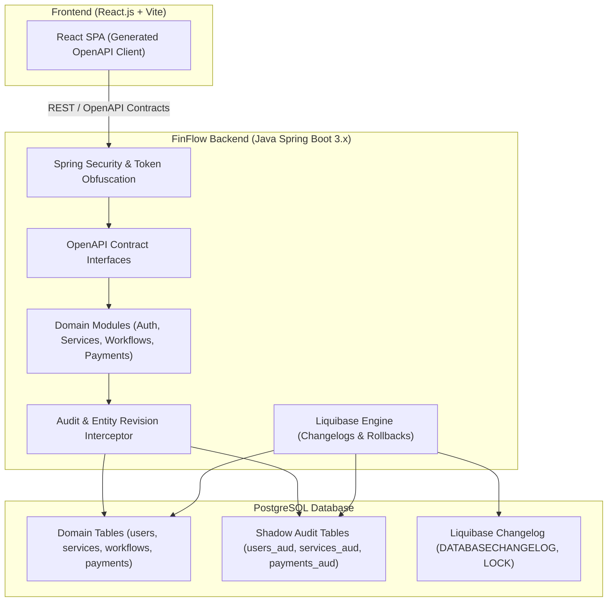

# Technical Overview Document

**Project Name:** FinFlow - Personal Finance & Service Manager  
**Version:** 1.1  
**Date:** October 12, 2026

## 1. System Architecture

The FinFlow application follows a **modular monolith architecture**, built on an enterprise **Java Spring Boot ecosystem** for robust transactional integrity, strong type safety, and fine-grained security, paired with a modern **React (Vite)** frontend Single Page Application (SPA). 

FinFlow adopts a strict **Contract-First design pattern**, where OpenAPI specifications serve as the single source of truth connecting backend endpoints with frontend clients. Database evolution is governed by **Liquibase**, enforcing semantic changeset versioning, master changelogs, and mandatory rollback plans for all schema migrations. Every domain table is paired with a dedicated **shadow audit table (`*_aud`)** to guarantee auditable, point-in-time state tracking across the application.



## 2. Tech Stack Recommendation

| Component | Technology | Justification |
| ----- | ----- | ----- |
| **Language** | Java 17/21 (Backend) & TypeScript (Frontend) | Strong type safety, enterprise maintainability, and compile-time verification across financial domain logic. |
| **Backend Framework** | Java Spring Boot 3.x | Enterprise-grade, type-safe, and transactional, providing robust transaction management, Spring Security, and high-throughput execution. |
| **API Contracts** | OpenAPI 3.0 / 3.1 | **Contract-First approach**: Centralized OpenAPI schema (`api/openapi/`) from BE to FE. Drives server stubs and typed client generation. |
| **Primary Database** | PostgreSQL 15+ | ACID compliance is crucial for financial transactions. Supports complex queries, JSONB schemas, and relational integrity. |
| **Database Migrations** | Liquibase | Reproducible, version-controlled schema evolution with master changelogs, semantic versioning, and mandatory rollback plans. |
| **Audit Architecture** | Shadow Audit Tables (`*_aud`) | Dedicated audit shadow table for every domain table, capturing historical revisions (INSERT, UPDATE, DELETE) for complete audit trail retrieval. |
| **Cache & Sessions** | Redis | High-performance in-memory store for session management, rate limiting, and workflow event queues. |
| **Authentication** | Spring Security (Google OAuth2) & RFC 6238 TOTP (2FA) | Industry-standard enterprise security framework for implementing secure OAuth2 flows and two-factor authentication. |
| **Encryption** | Java Cryptography Architecture (AES-256-GCM) & AWS KMS | AES-256-GCM for field-level encryption of PII at rest via JPA attribute converters. AWS KMS / Vault for secure key management. |
| **Payments** | Razorpay / Cashfree Java SDK | Best-in-class for Indian payment gateways; native UPI support, HMAC-SHA256 signature verification, and Redis-backed idempotency. |
| **Workflow Engine** | Camunda / Flowable / Spring StateMachine | BPMN 2.0 compliant visual workflow engine to define and execute service lifecycles (pre-payment notices, due-expiry alerts, reschedule policies). |
| **Frontend** | React.js (Vite) | High-performance Single Page Application (SPA) with fast build times, component-based UI, Tailwind CSS, TanStack Query, and Zustand. |
| **Logging** | SLF4J + Logback with EFK / Loki Stack | Structured logging with automated PII masking and centralized log aggregation, analysis, and visualization. |
| **Infrastructure** | Docker & Kubernetes (AWS EKS / GCP GKE) | Unified containerization with Docker Compose locally and managed cloud services (RDS, ElastiCache, KMS) in production. |

## 3. Core Technical Concepts

### 3.1 Contract-First API Development (OpenAPI from BE to FE)
* **Single Source of Truth**: All REST endpoints, request payloads, response DTOs, and error models are defined in centralized OpenAPI specifications (`api/openapi/finflow-api.yaml`).
* **Backend Code Generation**: The `openapi-generator-maven-plugin` generates Spring MVC controller interfaces and DTO models during build time. Developers implement generated interface contracts, preventing endpoint divergence.
* **Frontend Client Generation**: The React Vite application consumes the backend OpenAPI specification using tooling (e.g. `openapi-typescript` / Axios generator) to generate strictly-typed API client services and TypeScript models (`npm run generate:api`).
* **Contract Verification**: Continuous Integration builds fail if controller implementations drift from the OpenAPI specification or if breaking schema changes are introduced.

### 3.2 Database Migration & Versioning Strategy (Liquibase)
* **Changelog Architecture**:
  * **Master Changelog**: `src/main/resources/db/changelog/db.changelog-master.xml` serves as the root manifest.
  * **Release / Module Changelogs**: Structured hierarchically by release version (e.g., `db/changelog/v1.0.0/db.changelog-v1.0.0.xml`, `db/changelog/v1.1.0/`).
* **Strict Changeset Versioning**:
  * Every migration step is an isolated changeset with a standardized naming convention: `<version>-<sequence>-<description>` (e.g., `v1.0.0-001-create-users-table.xml`).
  * Changesets include explicit `id`, `author`, and `<tagDatabase>` milestones corresponding to software releases.
* **Mandatory Rollback Plans**:
  * **Zero Migrations Without Rollbacks**: Every changeset MUST define an explicit `<rollback>` block (e.g., `<rollback><dropTable tableName="users"/></rollback>` or SQL inversion script).
  * Automated CI pipeline validates rollbacks by executing `mvn liquibase:update-testing-rollback` before approving deployments.
* **State Tracking**:
  * Liquibase maintains migration history and execution locks directly within PostgreSQL via `DATABASECHANGELOG` and `DATABASECHANGELOGLOCK` tables.

### 3.3 Per-Table Audit Architecture & Audit Log Fetching
* **Dedicated Shadow Audit Tables**:
  * Every functional domain table in the database is paired with a corresponding audit shadow table suffixed with `_aud` (e.g., `users_aud`, `roles_aud`, `user_privileges_aud`, `services_aud`, `workflows_aud`, `payments_aud`).
* **Audit Table Schema Structure**:
  * `audit_id` (BIGSERIAL / UUID, PK): Unique identifier for the audit revision.
  * `entity_id` (UUID / PK): Foreign reference to the affected domain entity ID.
  * `rev_type` (VARCHAR): Modification operation (`INSERT`, `UPDATE`, `DELETE`).
  * `diff_data` (JSONB) or Full Snapshot: Snapshot of changed fields or complete entity state at the time of modification.
  * `modified_by` (VARCHAR): Obfuscated / tokenized user ID of the authenticated actor who initiated the change.
  * `ip_address` (VARCHAR): Client IP address recorded during the request.
  * `rev_timestamp` (TIMESTAMP WITH TIME ZONE, immutable): Precise UTC timestamp of the change.
* **Audit Interception & Population**:
  * Auditing is captured via JPA entity listeners / Hibernate Envers / PostgreSQL database triggers and Spring AOP audit interceptors (`@AuditAction`).
  * Mutating transactions write to both the target entity table and its shadow audit table within the same ACID database transaction.
* **Audit Log Retrieval Engine**:
  * A dedicated backend audit service queries these `_aud` tables to satisfy compliance, forensics, and admin dashboard queries:
    * **Entity History Query**: Retrieve complete chronological changes for a specific record (e.g., `GET /api/v1/audit/users/{id}/history`).
    * **Timeline & Aggregated Logs**: Query cross-entity audit events with filtering by date range, actor, revision type, and entity type (`GET /api/v1/audit/logs`).
    * **Time-Travel Diffing**: Compare consecutive revisions to show exact before-and-after values.

### 3.4 Security Flow (Encryption & Obfuscated Token Exchange)
* **Authentication**: User authenticates via Google OAuth2 + RFC 6238 TOTP (2FA).
* **Per-Session Encryption Token**: Upon authentication, the backend generates a JWT and binds an ephemeral AES encryption token to the user session in Redis.
* **ID Obfuscation**: Database primary keys are never sent cleartext to the client; all IDs are encrypted into session-scoped tokens.
* **Decryption Filter & Retry**:
  * Spring Security filter (`IdTokenDecryptionFilter`) decrypts ID tokens on incoming requests.
  * If decryption fails, the server returns HTTP `449 (Retry With New Token)` triggering an automatic client token refresh.
  * After 3 consecutive decryption failures within a session, the backend terminates the session and forces re-authentication.

### 3.5 Workflow Management
* Admin-defined BPMN schemas are stored as JSON/XML in PostgreSQL.
* Camunda / Flowable / Spring StateMachine executes workflow instances upon service subscription or payment triggers.
* Workflow tasks (e.g., reminders, due notices) are processed asynchronously via Redis queues and Spring `@Async` workers.

## 4. Database Schema Sketch (High-Level)

### 4.1 Domain & Shadow Audit Tables
```sql
-- 1. Users & Audit
CREATE TABLE users (
    id UUID PRIMARY KEY,
    encrypted_name VARCHAR(255),
    encrypted_email VARCHAR(255),
    role_id INT REFERENCES roles(id),
    encrypted_phone VARCHAR(255),
    twofa_secret VARCHAR(255),
    created_at TIMESTAMP WITH TIME ZONE DEFAULT NOW()
);

CREATE TABLE users_aud (
    audit_id BIGSERIAL PRIMARY KEY,
    id UUID NOT NULL,
    rev_type VARCHAR(10) NOT NULL, -- 'INSERT', 'UPDATE', 'DELETE'
    encrypted_name VARCHAR(255),
    encrypted_email VARCHAR(255),
    role_id INT,
    encrypted_phone VARCHAR(255),
    diff_data JSONB,
    modified_by VARCHAR(100),
    ip_address VARCHAR(45),
    rev_timestamp TIMESTAMP WITH TIME ZONE DEFAULT NOW()
);

-- 2. Services & Audit
CREATE TABLE services (
    id UUID PRIMARY KEY,
    name VARCHAR(100) NOT NULL,
    description TEXT,
    is_active BOOLEAN DEFAULT TRUE,
    created_by UUID REFERENCES users(id),
    created_at TIMESTAMP WITH TIME ZONE DEFAULT NOW()
);

CREATE TABLE services_aud (
    audit_id BIGSERIAL PRIMARY KEY,
    id UUID NOT NULL,
    rev_type VARCHAR(10) NOT NULL,
    name VARCHAR(100),
    description TEXT,
    is_active BOOLEAN,
    diff_data JSONB,
    modified_by VARCHAR(100),
    ip_address VARCHAR(45),
    rev_timestamp TIMESTAMP WITH TIME ZONE DEFAULT NOW()
);

-- 3. User Privileges & Audit
CREATE TABLE user_privileges (
    id UUID PRIMARY KEY,
    user_id UUID REFERENCES users(id),
    feature_id VARCHAR(50) NOT NULL,
    status VARCHAR(20) NOT NULL, -- 'requested', 'approved', 'rejected'
    requested_at TIMESTAMP WITH TIME ZONE DEFAULT NOW(),
    approved_by UUID REFERENCES users(id)
);

CREATE TABLE user_privileges_aud (
    audit_id BIGSERIAL PRIMARY KEY,
    id UUID NOT NULL,
    rev_type VARCHAR(10) NOT NULL,
    user_id UUID,
    feature_id VARCHAR(50),
    status VARCHAR(20),
    diff_data JSONB,
    modified_by VARCHAR(100),
    ip_address VARCHAR(45),
    rev_timestamp TIMESTAMP WITH TIME ZONE DEFAULT NOW()
);

-- 4. Workflows & Audit
CREATE TABLE workflows (
    id UUID PRIMARY KEY,
    service_id UUID REFERENCES services(id),
    bpmn_schema JSONB NOT NULL,
    version INT NOT NULL,
    is_current BOOLEAN DEFAULT TRUE,
    created_at TIMESTAMP WITH TIME ZONE DEFAULT NOW()
);

CREATE TABLE workflows_aud (
    audit_id BIGSERIAL PRIMARY KEY,
    id UUID NOT NULL,
    rev_type VARCHAR(10) NOT NULL,
    service_id UUID,
    bpmn_schema JSONB,
    version INT,
    diff_data JSONB,
    modified_by VARCHAR(100),
    ip_address VARCHAR(45),
    rev_timestamp TIMESTAMP WITH TIME ZONE DEFAULT NOW()
);

-- 5. Payments & Audit
CREATE TABLE payments (
    id UUID PRIMARY KEY,
    user_id UUID REFERENCES users(id),
    service_id UUID REFERENCES services(id),
    amount NUMERIC(12, 2) NOT NULL,
    currency VARCHAR(3) DEFAULT 'INR',
    status VARCHAR(20) NOT NULL, -- 'PENDING', 'COMPLETED', 'FAILED'
    gateway_txn_id VARCHAR(100),
    idempotency_key VARCHAR(100) UNIQUE,
    created_at TIMESTAMP WITH TIME ZONE DEFAULT NOW()
);

CREATE TABLE payments_aud (
    audit_id BIGSERIAL PRIMARY KEY,
    id UUID NOT NULL,
    rev_type VARCHAR(10) NOT NULL,
    amount NUMERIC(12, 2),
    status VARCHAR(20),
    gateway_txn_id VARCHAR(100),
    diff_data JSONB,
    modified_by VARCHAR(100),
    ip_address VARCHAR(45),
    rev_timestamp TIMESTAMP WITH TIME ZONE DEFAULT NOW()
);

-- 6. Liquibase Migration Tracking Tables
-- DATABASECHANGELOG: (id, author, filename, dateexecuted, orderexecuted, exectype, md5sum, description, tag)
-- DATABASECHANGELOGLOCK: (id, locked, lockgranted, lockedby)
```

## 5. Deployment Strategy

1. **Containerization:** Dockerize all services (Backend Spring Boot API, Worker, Frontend Nginx SPA).  
2. **Database Migration Pipeline:** Run Liquibase migrations automatically on application startup or via a standalone pre-deployment Kubernetes init container/job:
   ```bash
   mvn liquibase:update
   ```
3. **Rollback Testing in CI:** Execute Liquibase automated rollback verification on staging environments:
   ```bash
   mvn liquibase:update-testing-rollback
   ```
4. **Orchestration:** Use Kubernetes (EKS/GKE) for deployment, scaling, and rolling updates.  
5. **CI/CD:** Automate build, contract validation, and deployment pipelines using GitHub Actions or GitLab CI.  
6. **Environment Management:** Use AWS Secrets Manager / Vault to store all API keys (Razorpay, Twilio) and database credentials.  
7. **Monitoring:** Use Prometheus for metrics collection and Grafana for dashboards to monitor application health and performance (Spring Boot Actuator).

## 6. Key Improvement Recommendations

* **Automated Contract Drift Detection:** Run OpenAPI schema diff checks in CI to prevent breaking changes between frontend and backend.
* **Liquibase Rollback Verification:** Mandate automated rollback verification (`mvn liquibase:rollback -Dliquibase.rollbackCount=1`) in CI test pipelines before allowing release merges.
* **Audit Log Partitioning:** Implement PostgreSQL time-based table partitioning (declarative partitioning by month) on high-volume shadow audit tables (`payments_aud`, `users_aud`) for optimal query performance and archival retention.
* **Webhook Resilience:** Implement an idempotency mechanism for payment webhooks to ensure duplicate webhook events do not double-credit accounts.
* **Rate Limiting:** Implement Redis-backed distributed rate limiting (Bucket4j with Redis) to prevent API abuse.
