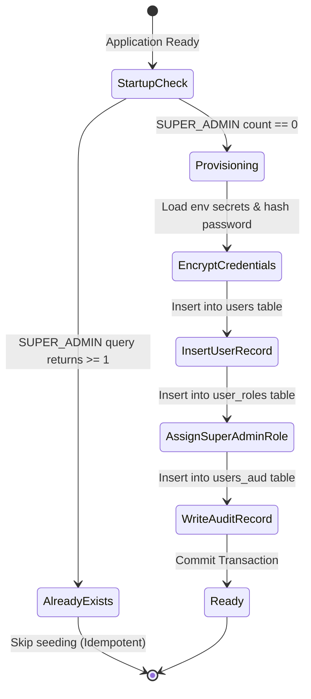

# Data Model: Module 1 — Application Foundation

**Feature ID:** MOD-001  
**Module:** Application Foundation  
**Branch:** `001-app-foundation`  
**Date:** 2026-10-12  

---

## 1. Overview & Scope

Module 1 establishes the baseline database schemas, audit shadow structures, and foundational entities required before any business or security modules operate. 
It defines:
- The initial `users` and `roles` schema necessary to provision the default **Super Admin**.
- The shadow audit table contract (`users_aud` and standard template for all future `*_aud` tables).
- System-managed entities for database migrations (Liquibase tracking tables).
- In-memory / request context models (Correlation Context, Redis Pool state).

---

## 2. Relational Database Entities (PostgreSQL)

### 2.1. `users` Table (Foundation Initial Schema)

The core user account record provisioned for the Super Admin on initial boot. Subsequent modules (Module 2 Auth, Module 3 RBAC, Module 4 Administration) build upon this table.

```sql
CREATE TABLE users (
    id UUID PRIMARY KEY DEFAULT gen_random_uuid(),
    email VARCHAR(500) NOT NULL UNIQUE,          -- AES-256-GCM encrypted string
    password_hash VARCHAR(255) NOT NULL,          -- BCrypt hash (cost factor 12)
    first_name VARCHAR(255) NOT NULL,            -- AES-256-GCM encrypted string
    last_name VARCHAR(255) NOT NULL,             -- AES-256-GCM encrypted string
    phone VARCHAR(255),                          -- AES-256-GCM encrypted string (nullable)
    status VARCHAR(30) NOT NULL DEFAULT 'ACTIVE', -- 'ACTIVE', 'PENDING_APPROVAL', 'REJECTED', 'SUSPENDED'
    must_change_password BOOLEAN NOT NULL DEFAULT FALSE,
    created_at TIMESTAMP WITH TIME ZONE NOT NULL DEFAULT NOW(),
    updated_at TIMESTAMP WITH TIME ZONE NOT NULL DEFAULT NOW()
);
```

#### Fields & Types
| Column Name | SQL Type | Nullable | Description | Validation / Constraints |
|:---|:---|:---|:---|:---|
| `id` | `UUID` | No | Primary Key | Auto-generated UUIDv4 |
| `email` | `VARCHAR(500)` | No | Encrypted Email Address | AES-256-GCM ciphertext; Unique index |
| `password_hash`| `VARCHAR(255)` | No | BCrypt password hash | Valid BCrypt string (length 60) |
| `first_name` | `VARCHAR(255)` | No | Encrypted First Name | AES-256-GCM ciphertext |
| `last_name` | `VARCHAR(255)` | No | Encrypted Last Name | AES-256-GCM ciphertext |
| `phone` | `VARCHAR(255)` | Yes | Encrypted Phone Number | AES-256-GCM ciphertext (optional) |
| `status` | `VARCHAR(30)` | No | Account status | Valid enum: `ACTIVE`, `PENDING_APPROVAL`, `REJECTED`, `SUSPENDED` |
| `must_change_password` | `BOOLEAN` | No | Forced reset flag | Default `TRUE` for seeded super admin |
| `created_at` | `TIMESTAMPTZ` | No | Record creation instant | UTC timestamp |
| `updated_at` | `TIMESTAMPTZ` | No | Record update instant | UTC timestamp |

---

### 2.2. `roles` & `user_roles` Tables

Minimal role associations created during foundation bootstrap to assign the seeded Super Admin account its administrative authority.

```sql
CREATE TABLE roles (
    name VARCHAR(50) PRIMARY KEY,
    description VARCHAR(255) NOT NULL,
    created_at TIMESTAMP WITH TIME ZONE NOT NULL DEFAULT NOW()
);

CREATE TABLE user_roles (
    user_id UUID NOT NULL REFERENCES users(id) ON DELETE CASCADE,
    role_name VARCHAR(50) NOT NULL REFERENCES roles(name) ON DELETE CASCADE,
    assigned_at TIMESTAMP WITH TIME ZONE NOT NULL DEFAULT NOW(),
    PRIMARY KEY (user_id, role_name)
);
```

#### Initial Seed Data (Foundation)
| Role Name | Description |
|:---|:---|
| `SUPER_ADMIN` | Highest system privilege; full administrative and bootstrap access |
| `ADMIN` | General system administrator |
| `END_USER` | Standard approved platform user |

---

### 2.3. Shadow Audit Table Contract (`users_aud`)

In compliance with Constitution Principle III, every domain table has an immutable shadow table recording state deltas within the same transaction.

```sql
CREATE TABLE users_aud (
    audit_id BIGSERIAL PRIMARY KEY,
    id UUID NOT NULL,
    rev_type VARCHAR(10) NOT NULL,               -- 'INSERT', 'UPDATE', 'DELETE'
    diff_data JSONB,                             -- Field-level delta (PII masked)
    modified_by VARCHAR(100) NOT NULL,           -- Obfuscated User ID or 'SYSTEM_BOOTSTRAP'
    ip_address VARCHAR(45),                      -- Client IPv4 / IPv6
    rev_timestamp TIMESTAMP WITH TIME ZONE NOT NULL DEFAULT NOW()
);

CREATE INDEX idx_users_aud_entity_id ON users_aud(id);
CREATE INDEX idx_users_aud_timestamp ON users_aud(rev_timestamp DESC);
CREATE INDEX idx_users_aud_actor ON users_aud(modified_by);
```

#### Diff Data JSONB Schema
```json
{
  "status": {
    "old": null,
    "new": "ACTIVE"
  },
  "must_change_password": {
    "old": null,
    "new": true
  },
  "roles": {
    "old": [],
    "new": ["SUPER_ADMIN"]
  }
}
```
*Note: Any sensitive PII attributes (email, names, passwords) are scrubbed or masked in `diff_data` prior to database commit.*

---

### 2.4. Liquibase Migration System Tables

Managed natively by Liquibase 4.x:
1. `DATABASECHANGELOG`:
   - `id`: Changeset ID (e.g. `v1.0.0-001`)
   - `author`: Author string (e.g. `finflow-foundation`)
   - `filename`: Relative changelog path
   - `dateexecuted`: Timestamp
   - `orderexecuted`: Integer execution sequence
   - `exectype`: `EXECUTED`, `FAILED`, etc.
   - `md5sum`: Changeset checksum
   - `description`: Changeset summary
   - `comments`: Comments block
   - `tag`: Version tag (for rollback targeting)
   - `liquibase`: Liquibase engine version
2. `DATABASECHANGELOGLOCK`:
   - `id`: Lock ID (always 1)
   - `locked`: Boolean
   - `lockgranted`: Timestamp when locked
   - `lockedby`: Host/pod identifier holding the migration lock

---

## 3. Ephemeral & In-Memory Entities

### 3.1. `CorrelationContext`
Managed via SLF4J MDC and thread-local HTTP request context:
- `correlationId`: UUIDv4 string (e.g. `c7b6496b-67df-42fe-bd12-87adffcfa261`)
- `clientIp`: Resolved IPv4 or IPv6 string
- `httpMethod`: `GET`, `POST`, `PUT`, `DELETE`, `OPTIONS`, etc.
- `requestUri`: Path excluding sensitive query parameters
- `startTimeNanos`: Request start timestamp in nanoseconds for duration computation

### 3.2. `RedisConnectionState`
Health check model evaluated by `RedisHealthValidator`:
- `status`: `UP`, `DOWN`, `DEGRADED`
- `latencyMillis`: Ping-pong roundtrip time
- `activeConnections`: Count of pooled connections
- `idleConnections`: Count of available idle connections

---

## 4. State Transitions

### Super Admin Provisioning Lifecycle

