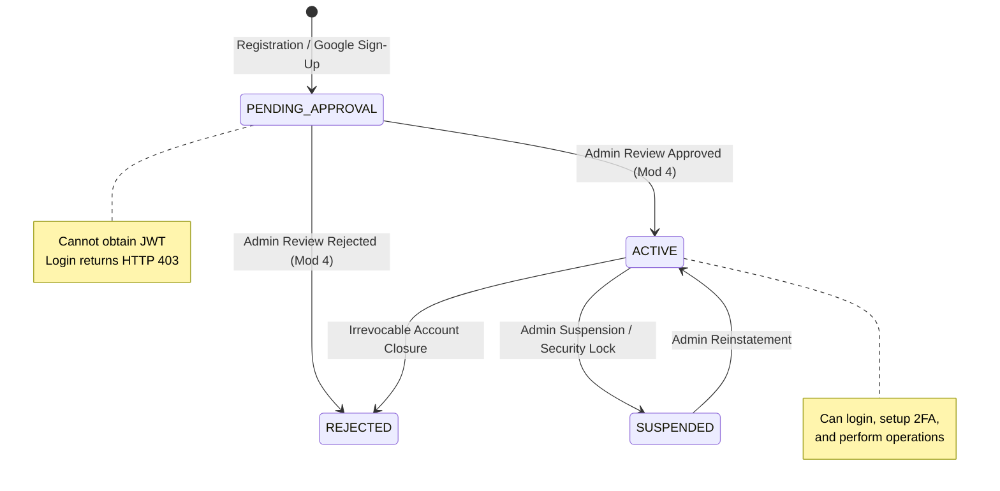
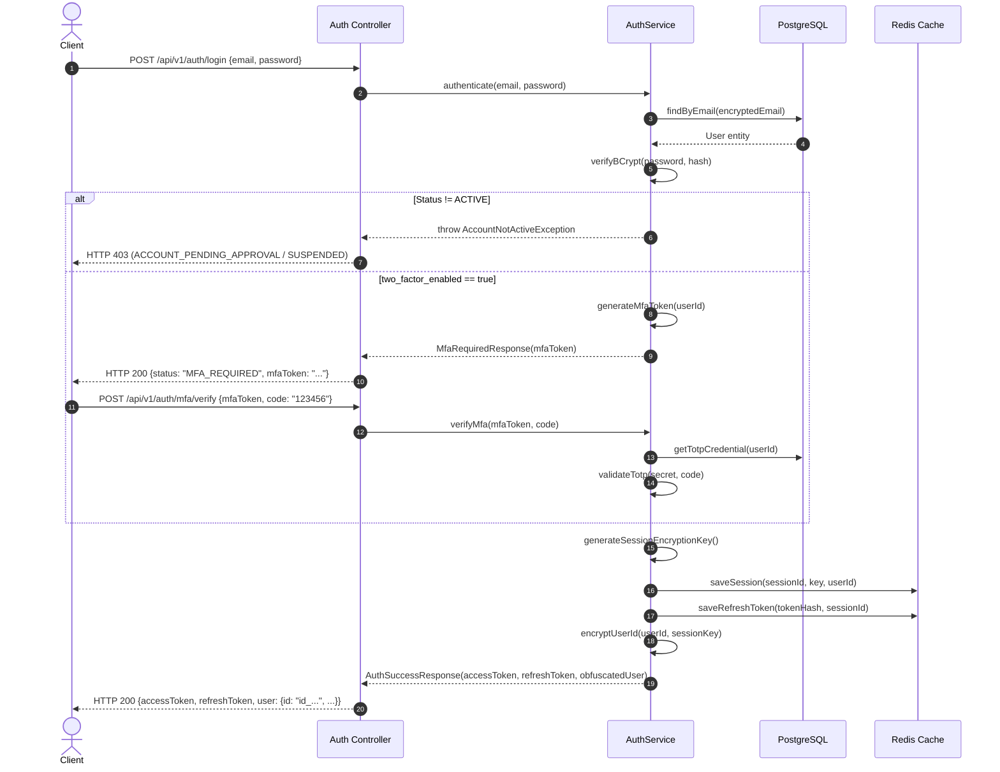
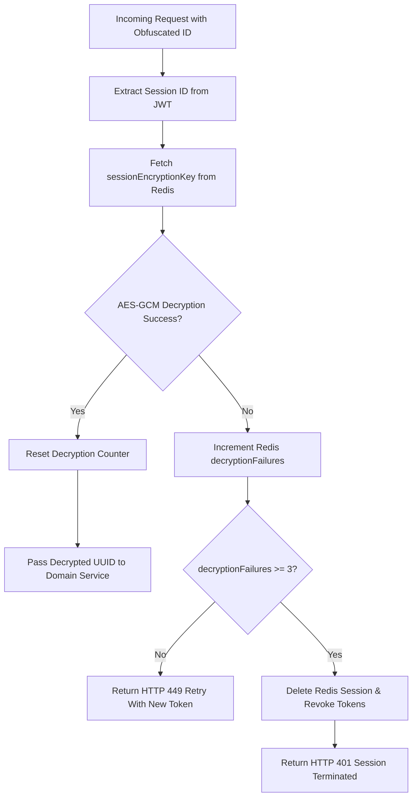

# Data Model: Module 2 — Authentication

**Feature ID:** MOD-002  
**Module:** Authentication  
**Branch:** `002-authentication`  
**Date:** 2026-10-12  

---

## 1. Overview & Scope

Module 2 provides the identity, credential, and session persistence layer for FinFlow. It extends the foundation schema with:
1. **Relational Schemas (PostgreSQL)**:
   - Enhanced `users` entity tracking two-factor flags and audit timestamps.
   - `user_totp_credentials` storing encrypted RFC 6238 TOTP secrets.
   - `federated_identities` mapping external OAuth2 identities (Google) to FinFlow accounts.
   - Shadow audit tables (`user_totp_credentials_aud`, `federated_identities_aud`, and updates to `users_aud`).
2. **Ephemeral Session & Token Storage (Redis)**:
   - Active user session records binding ephemeral AES ID-obfuscation keys.
   - Refresh token registry with 15-second rotation grace periods.
   - 15-minute password reset OTP records with rate-limiting counters.
   - 5-minute MFA login challenge state tokens.

---

## 2. Relational Database Entities (PostgreSQL)

### 2.1. Enhanced `users` Table

Extends the baseline `users` table created in Module 1:

```sql
ALTER TABLE users ADD COLUMN two_factor_enabled BOOLEAN NOT NULL DEFAULT FALSE;
ALTER TABLE users ADD COLUMN failed_login_attempts INT NOT NULL DEFAULT 0;
ALTER TABLE users ADD COLUMN last_login_at TIMESTAMP WITH TIME ZONE;
```

#### Complete Schema Definition:
```sql
CREATE TABLE users (
    id UUID PRIMARY KEY DEFAULT gen_random_uuid(),
    email VARCHAR(500) NOT NULL UNIQUE,          -- AES-256-GCM encrypted
    password_hash VARCHAR(255) NOT NULL,          -- BCrypt hash (cost factor 12)
    first_name VARCHAR(255) NOT NULL,            -- AES-256-GCM encrypted
    last_name VARCHAR(255) NOT NULL,             -- AES-256-GCM encrypted
    phone VARCHAR(255),                          -- AES-256-GCM encrypted (optional)
    status VARCHAR(30) NOT NULL DEFAULT 'PENDING_APPROVAL', -- 'PENDING_APPROVAL', 'ACTIVE', 'REJECTED', 'SUSPENDED'
    must_change_password BOOLEAN NOT NULL DEFAULT FALSE,
    two_factor_enabled BOOLEAN NOT NULL DEFAULT FALSE,
    failed_login_attempts INT NOT NULL DEFAULT 0,
    last_login_at TIMESTAMP WITH TIME ZONE,
    created_at TIMESTAMP WITH TIME ZONE NOT NULL DEFAULT NOW(),
    updated_at TIMESTAMP WITH TIME ZONE NOT NULL DEFAULT NOW()
);
```

#### Field Specifications:
| Column Name | SQL Type | Nullable | Description | Validation / Constraints |
|:---|:---|:---|:---|:---|
| `id` | `UUID` | No | Internal Primary Key | Never exposed over the wire |
| `email` | `VARCHAR(500)` | No | User email address | AES-256-GCM ciphertext; Unique |
| `password_hash` | `VARCHAR(255)` | No | Salted password hash | BCrypt (cost factor 12) |
| `first_name` | `VARCHAR(255)` | No | Legal first name | AES-256-GCM ciphertext |
| `last_name` | `VARCHAR(255)` | No | Legal last name | AES-256-GCM ciphertext |
| `phone` | `VARCHAR(255)` | Yes | Contact phone number | AES-256-GCM ciphertext |
| `status` | `VARCHAR(30)` | No | Account status | `PENDING_APPROVAL`, `ACTIVE`, `REJECTED`, `SUSPENDED` |
| `must_change_password` | `BOOLEAN` | No | Forced password change | Boolean flag |
| `two_factor_enabled` | `BOOLEAN` | No | TOTP 2FA activation status | Default `FALSE` |
| `failed_login_attempts` | `INT` | No | Consecutive failed logins | Cooldown trigger at 5 |
| `last_login_at` | `TIMESTAMPTZ` | Yes | Last successful login | UTC timestamp |
| `created_at` | `TIMESTAMPTZ` | No | Creation timestamp | UTC timestamp |
| `updated_at` | `TIMESTAMPTZ` | No | Last update timestamp | UTC timestamp |

---

### 2.2. `user_totp_credentials` Table

Stores encrypted shared secrets for RFC 6238 TOTP multi-factor authentication:

```sql
CREATE TABLE user_totp_credentials (
    id UUID PRIMARY KEY DEFAULT gen_random_uuid(),
    user_id UUID NOT NULL REFERENCES users(id) ON DELETE CASCADE,
    secret VARCHAR(500) NOT NULL,                -- AES-256-GCM encrypted Base32 secret
    confirmed_at TIMESTAMP WITH TIME ZONE,       -- Set when user verifies first 6-digit code
    created_at TIMESTAMP WITH TIME ZONE NOT NULL DEFAULT NOW(),
    updated_at TIMESTAMP WITH TIME ZONE NOT NULL DEFAULT NOW(),
    CONSTRAINT uk_user_totp_credentials_user UNIQUE (user_id)
);
```

#### Field Specifications:
| Column Name | SQL Type | Nullable | Description | Validation / Constraints |
|:---|:---|:---|:---|:---|
| `id` | `UUID` | No | Credential ID | Primary Key |
| `user_id` | `UUID` | No | Associated user | Foreign Key to `users(id)`, Unique |
| `secret` | `VARCHAR(500)` | No | Shared TOTP secret | 160-bit Base32 secret encrypted with AES-256-GCM |
| `confirmed_at` | `TIMESTAMPTZ` | Yes | Activation verification instant | NULL until first valid verification |
| `created_at` | `TIMESTAMPTZ` | No | Setup timestamp | UTC timestamp |
| `updated_at` | `TIMESTAMPTZ` | No | Modification timestamp | UTC timestamp |

---

### 2.3. `federated_identities` Table

Stores external identity provider accounts linked to FinFlow accounts:

```sql
CREATE TABLE federated_identities (
    id UUID PRIMARY KEY DEFAULT gen_random_uuid(),
    user_id UUID NOT NULL REFERENCES users(id) ON DELETE CASCADE,
    provider VARCHAR(50) NOT NULL,               -- 'GOOGLE'
    provider_subject_id VARCHAR(255) NOT NULL,   -- Google 'sub' claim
    email VARCHAR(500),                          -- AES-256-GCM encrypted federated email
    created_at TIMESTAMP WITH TIME ZONE NOT NULL DEFAULT NOW(),
    updated_at TIMESTAMP WITH TIME ZONE NOT NULL DEFAULT NOW(),
    CONSTRAINT uk_federated_provider_sub UNIQUE (provider, provider_subject_id)
);

CREATE INDEX idx_federated_identities_user ON federated_identities(user_id);
```

#### Field Specifications:
| Column Name | SQL Type | Nullable | Description | Validation / Constraints |
|:---|:---|:---|:---|:---|
| `id` | `UUID` | No | Identity Link ID | Primary Key |
| `user_id` | `UUID` | No | Linked local user | Foreign Key to `users(id)` |
| `provider` | `VARCHAR(50)` | No | Identity Provider code | `GOOGLE` |
| `provider_subject_id` | `VARCHAR(255)` | No | Provider unique subject ID | External sub claim; Unique per provider |
| `email` | `VARCHAR(500)` | Yes | Verified email at provider | AES-256-GCM ciphertext |
| `created_at` | `TIMESTAMPTZ` | No | Association timestamp | UTC timestamp |
| `updated_at` | `TIMESTAMPTZ` | No | Last update timestamp | UTC timestamp |

---

### 2.4. Shadow Audit Tables

In strict adherence to Constitution Principle III, all mutating identity tables maintain immutable audit shadow tables populated in the same ACID transaction:

#### 2.4.1. `user_totp_credentials_aud` Table
```sql
CREATE TABLE user_totp_credentials_aud (
    audit_id BIGSERIAL PRIMARY KEY,
    id UUID NOT NULL,
    rev_type VARCHAR(10) NOT NULL,               -- 'INSERT', 'UPDATE', 'DELETE'
    diff_data JSONB,                             -- State delta with secret masked
    modified_by VARCHAR(100) NOT NULL,           -- Obfuscated User ID
    ip_address VARCHAR(45),                      -- Client IPv4 / IPv6
    rev_timestamp TIMESTAMP WITH TIME ZONE NOT NULL DEFAULT NOW()
);

CREATE INDEX idx_user_totp_aud_entity_id ON user_totp_credentials_aud(id);
CREATE INDEX idx_user_totp_aud_timestamp ON user_totp_credentials_aud(rev_timestamp DESC);
```

#### 2.4.2. `federated_identities_aud` Table
```sql
CREATE TABLE federated_identities_aud (
    audit_id BIGSERIAL PRIMARY KEY,
    id UUID NOT NULL,
    rev_type VARCHAR(10) NOT NULL,               -- 'INSERT', 'UPDATE', 'DELETE'
    diff_data JSONB,                             -- State delta (PII masked)
    modified_by VARCHAR(100) NOT NULL,           -- Obfuscated User ID
    ip_address VARCHAR(45),                      -- Client IPv4 / IPv6
    rev_timestamp TIMESTAMP WITH TIME ZONE NOT NULL DEFAULT NOW()
);

CREATE INDEX idx_federated_aud_entity_id ON federated_identities_aud(id);
CREATE INDEX idx_federated_aud_timestamp ON federated_identities_aud(rev_timestamp DESC);
```

---

## 3. Ephemeral & Redis Key Schemas

All session, token, and challenge state is tracked in Redis. In-memory application maps are strictly prohibited by Constitution Technology Standards.

### 3.1. Session Record (`auth:session:{sessionId}`)
- **Key**: `auth:session:{sessionId}` (e.g. `auth:session:7e1465d6-3e42-4f81-9b16-86f2b489ef01`)
- **Type**: String (JSON) or Hash
- **TTL**: 7 days (604,800 seconds)
- **Schema**:
```json
{
  "sessionId": "7e1465d6-3e42-4f81-9b16-86f2b489ef01",
  "userId": "d9b2d354-938b-4c6e-8ff4-5f17d23a1052",
  "sessionEncryptionKey": "MDEyMzQ1Njc4OWFiY2RlZjAxMjM0NTY3ODlhYmNkZWY=",
  "decryptionFailures": 0,
  "userStatus": "ACTIVE",
  "roles": ["END_USER"],
  "privileges": ["AUTH:LOGIN", "AUTH:UPDATE_PROFILE", "TRANSACTION:READ"],
  "createdAt": "2026-10-12T14:30:00Z",
  "lastActivityAt": "2026-10-12T14:30:00Z"
}
```

### 3.2. Refresh Token Index (`auth:refresh:{tokenHash}`)
- **Key**: `auth:refresh:{sha256(refreshToken)}`
- **Type**: String (JSON)
- **TTL**: 7 days (604,800 seconds)
- **Schema**:
```json
{
  "sessionId": "7e1465d6-3e42-4f81-9b16-86f2b489ef01",
  "userId": "d9b2d354-938b-4c6e-8ff4-5f17d23a1052",
  "expiresAt": "2026-10-19T14:30:00Z"
}
```

### 3.3. Refresh Token Grace Window (`auth:refresh:grace:{oldTokenHash}`)
- **Key**: `auth:refresh:grace:{sha256(oldRefreshToken)}`
- **Type**: String (JSON)
- **TTL**: 15 seconds
- **Schema**:
```json
{
  "accessToken": "eyJhbGciOiJIUzI1NiIsInR5cCI6...",
  "refreshToken": "ff_ref_98a76bc3d...",
  "sessionId": "7e1465d6-3e42-4f81-9b16-86f2b489ef01"
}
```

### 3.4. Password Reset OTP (`auth:otp:password_reset:{userId}`)
- **Key**: `auth:otp:password_reset:{userId}`
- **Type**: String (JSON)
- **TTL**: 15 minutes (900 seconds)
- **Schema**:
```json
{
  "hashedOtp": "e3b0c44298fc1c149afbf4c8996fb92427ae41e4649b934ca495991b7852b855",
  "attempts": 0,
  "expiresAt": "2026-10-12T14:45:00Z"
}
```

### 3.5. TOTP Replay Prevention (`auth:totp:verified:{userId}:{timeStep}`)
- **Key**: `auth:totp:verified:{userId}:{timeStep}`
- **Type**: String ("1")
- **TTL**: 90 seconds (covers the ±1 window)

### 3.6. User Active Sessions Set (`auth:user_sessions:{userId}`)
- **Key**: `auth:user_sessions:{userId}`
- **Type**: Set (set of `sessionId` strings)
- **TTL**: 7 days
- **Purpose**: Enables immediate revocation of all sessions during password reset or account suspension.

---

## 4. State Transitions & Lifecycle

### 4.1. Account Status Lifecycle


### 4.2. Authentication Flow with Optional 2FA


### 4.3. ID Obfuscation Decryption & Circuit Breaker

